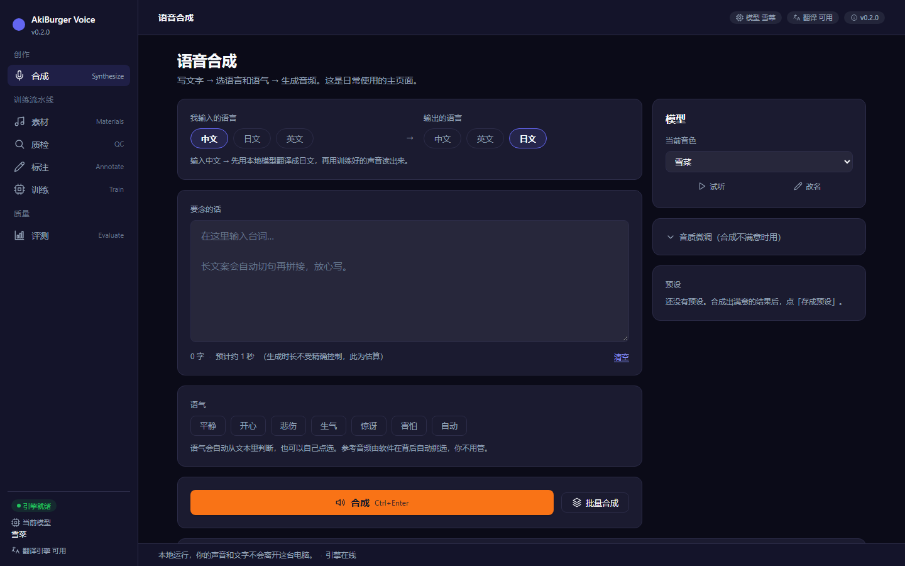
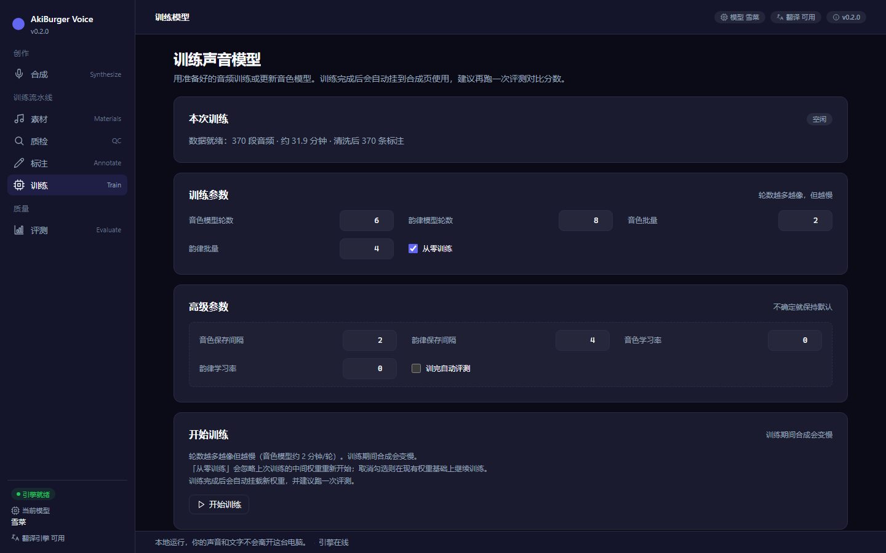
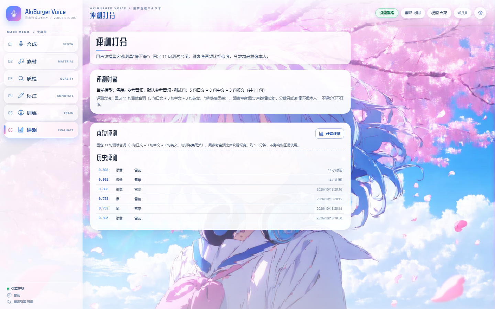
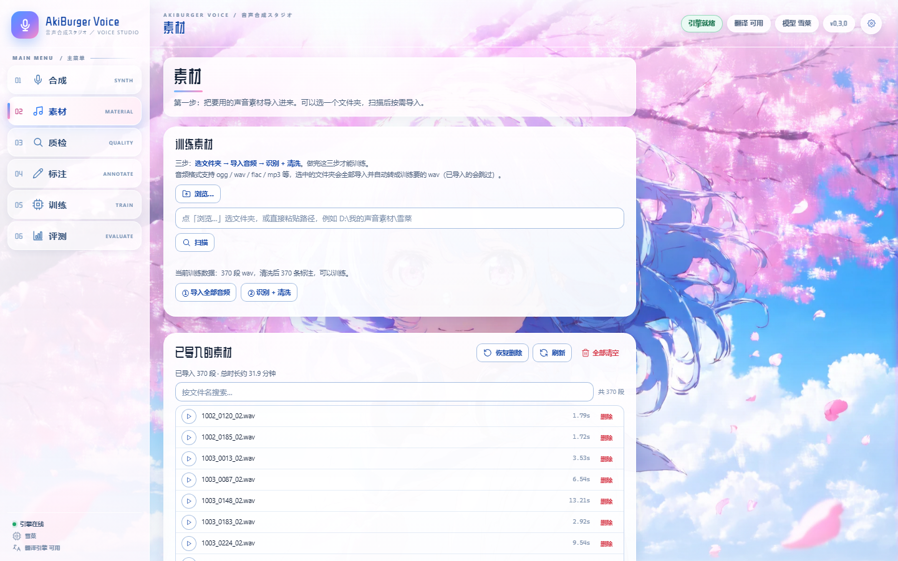
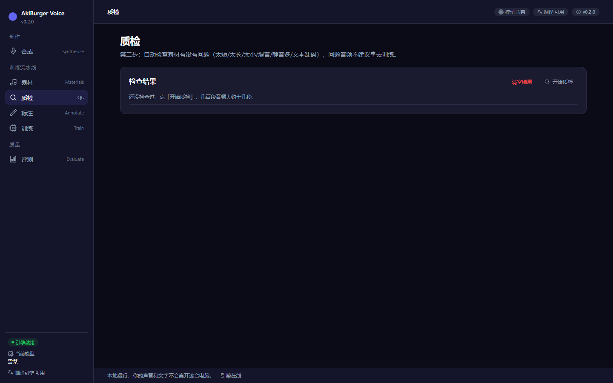
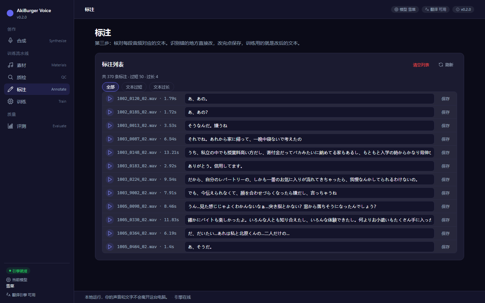
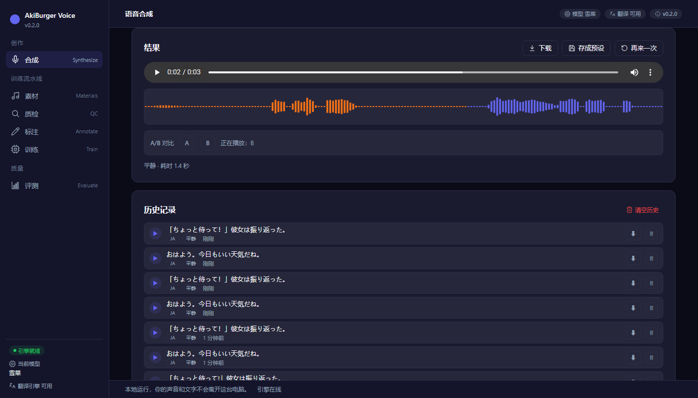

# AkiBurger Voice

**一个本地 Windows 桌面工具：把「素材 → 质检 → 标注 → 训练 → 评测 → 合成」串成一条流水线，用你自己的声音说中文、日文、英文。**

[](LICENSE)


> 全部本地运行 —— 素材、模型、合成结果都留在你自己电脑上，不经过任何服务器。
> 训练与合成引擎是 [GPT-SoVITS](https://github.com/RVC-Boss/GPT-SoVITS) v2Pro。

---

## 这是什么

不是"抓一个模型包一层界面"。这个项目把声音克隆拆成六个页面，每一环都单独选过工具，
训完自动用声纹模型给"像不像"打分 —— **把训练从玄学变成可对比的数字**。

```
素材  →  质检  →  标注  →  训练  →  评测  →  合成
导入音频   查问题    核对文本   训模型    打分数   出配音
```

它做两件事：

1. **造声音** —— 导入音频、自动识别、清洗、训练，产出人声模型
2. **用声音** —— 选一个模型，输入文案，输出中文／日文／英文配音

---

## 功能清单（六页流程）

| 页面 | 能做什么 | 细节 |
|---|---|---|
| 🎵 **素材** | 导入训练音频 | 浏览文件夹 → 扫描 → 一键导入（自动转 16k 单声道 wav，已导入的跳过）；支持 ogg / wav / flac / mp3 / m4a / aac / opus / wma；再次「识别 + 清洗」得到训练清单；删除进回收站，可恢复 |
| 🔍 **质检** | 自动查素材问题 | 音频：太短 / 太长 / 声音太小 / 静音太多 / 爆音 / 读不出来；文本：乱码、重复字符、太长太短、同句重复。结果分「通过 / 警告 / 不合格」，可筛选 |
| ✍️ **标注** | 核对并修改文本 | 逐条试听 + 改识别错的文本；保存自动备份（最近 10 份），写回训练清单 |
| 🎬 **训练** | 一键训练模型 | GPT-SoVITS v2Pro 微调：音色模型（SoVITS）+ 韵律模型（GPT）；后台跑、实时日志与阶段进度、可随时停止、训完自动挂载新权重；轮数 / 批量 / 保存间隔 / 学习率可调，可勾选"训完自动评测" |
| 📊 **评测** | 给"像不像"打分 | 自动合成 11 句测试台词（5 日 + 3 中 + 3 英），用 ERes2NetV2 声纹模型算相似度；≥0.78 很像 / ≥0.65 像 / ≥0.50 一般 / <0.50 不像；保留历史评测，方便对比不同训练版本 |
| 🎙️ **合成** | 文字转语音 | 输入 / 输出语言（中 / 日 / 英，跨语言自动翻译：中→日有内置模型兜底，其它方向需 Ollama）；语气自动判断 + 可手动改；长文案自动切句；稳定度 / 随机种子可调；批量合成（每行一句，可用「语气｜台词」指定单句语气）；历史记录（最近 20 条）、下载、预设（存在浏览器本地） |

**模型与参数在合成页右栏：** 模型下拉（自动扫描训练出的权重）、试听、给模型改名；当前模型同时显示在顶部状态条和左侧栏底部。

---

## 界面预览

> 界面按开源设计系统重做（v0.2.0）：深靛蓝深色底 + 暖橙唯一主 CTA + Inter 排版 + 内联 SVG 图标，
> 左侧 220px 分组导航（创作 / 训练流水线 / 质量）+ 顶部状态条 + 单页内容区，一次只看一页。
> 设计规范见 [docs/02-界面设计.md](docs/02-界面设计.md) 与 [design-system/akiburger-voice/MASTER.md](design-system/akiburger-voice/MASTER.md)。

**合成页（空状态）** —— 日常主页面：左栏写台词、选语言与语气，右栏调模型与预设。



**训练页** —— 数据就绪后一键训练：轮数、批量、从零训练与高级参数分区排列。



**评测页** —— 声纹相似度打分；历史评测按分数分档保留，方便对比不同训练版本。



**素材页** —— 导入 / 识别训练素材；图示为已导入 370 段、约 31.9 分钟的素材列表。



**质检页** —— 自动检查音频时长 / 音量 / 静音 / 爆音与文本乱码、重复，按通过 / 警告 / 不合格分类。



**标注页** —— 逐条试听并修改识别文本，保存即写回训练清单。



**结果区（波形 + A/B 对比）** —— 合成完成后显示波形；最近两次结果可 A/B 切换试听，下方是合成历史。



---

## 它能做什么，不能做什么

**能做：**
- 用 30 分钟左右的素材训出一个像样的音色模型（RTX 4060 8G 实测：370 条 / 33 分钟音频，全流程约 35 分钟）
- 用训好的模型给中 / 日 / 英文文案配音，长文自动切句、跨语言自动翻译
- 客观对比不同训练轮数的效果，挑分数高的留下

**暂时不能：**
- **相似度的上限由数据决定**。软件能做的是把数据洗干净、标注改对、参数选好；
  一段满是杂音的录音，任何软件都救不回来。这是预期，不是 bug。
- 语气判断 v1 用的是关键词规则（自动判断结果会显示出来，可手动改）；
  按语气自动挑选参考音频片段还在后续计划里，当前版本的语气选择不改变实际音色参考。
- 不做视频配音、不做人声分离、不做手机版 / 网页版 / 在线服务。
- 需要 NVIDIA 显卡（8GB 显存起步）；Windows 专用（启动器和文件夹选择框依赖 Windows）。
- 仓库不含模型与权重：GPT-SoVITS 本体、预训练模型、训练好的权重都要自己准备（见下一节）。

---

## 快速开始

### 一、前置条件

| 依赖 | 要求 | 说明 |
|---|---|---|
| **Windows** | 10 / 11 64 位 | 启动器、文件夹选择框、进程管理都依赖 Windows |
| **Python** | 3.10+ | 作者实测 3.13.15；GPT-SoVITS 官方建议 3.10 ~ 3.11 |
| **GPT-SoVITS** | v2Pro | 从 GitHub 上的 [GPT-SoVITS 官方仓库](https://github.com/RVC-Boss/GPT-SoVITS) 下载代码，并按它的 README 下载 v2Pro 预训练模型（几个 GB，不进本仓库） |
| **Fun-ASR-Nano 模型** | 要训练才需要 | 素材页的「识别 + 清洗」用，约 1.9GB，放 HF 缓存目录；`data/setsuna/batch_asr.py` 里写死了模型目录与快照路径，换机器要改这一行（见 [docs/07](docs/07-开源发布说明.md) 已知限制） |
| **ffmpeg** | 实测 7.x | 导入素材转码用；把 `ffmpeg.exe` 所在目录准备好（本机：`D:\Dev\tools\ffmpeg\bin`） |
| **NVIDIA GPU** | 8GB 显存起步 | RTX 4060 Laptop 8G 实测可训练；显存太小请先看[常见问题](#常见问题) |
| **Ollama + Qwen3** | 可选 | 本地大模型翻译更自然；不装会自动用内置的中→日小模型 |
| **.NET Framework 4.x** | 可选 | 只有重新编译启动器才需要（Windows 自带 csc.exe） |

### 二、目录约定

当前版本（v0.2）把作者机器的目录布局写死在启动器和部分模块里，**二选一**：

**方式 A：照这个布局放（最省事）**

```
D:\Dev\
├── ai\
│   └── 02_GPT-SoVITS_配音\
│       ├── .venv\                      ← GPT-SoVITS 的 Python 环境
│       └── GPT-SoVITS\                 ← 引擎源码（含 api_v2.py、预训练模型、权重目录）
├── cache\huggingface\hub\              ← HuggingFace 模型缓存
├── projects\
│   └── voice-studio\                   ← 本项目
└── tools\ffmpeg\bin\                   ← ffmpeg.exe
```

**方式 B：放到别处** —— 需要改路径常量，或设置环境变量。改动点集中在：

| 位置 | 写死的路径 |
|---|---|
| `launcher/launcher.cs` | `PROJECT_ROOT`、`AI_ROOT`、`FFMPEG_BIN` |
| `src/backend/app.py`、`trainer.py`、`evaluate.py` | 在 `D:\Dev\ai\02_GPT-SoVITS_*` 下自动探测引擎目录 |
| `src/backend/data_prep.py` | `D:\Dev\tools\ffmpeg\bin\ffmpeg.exe` |
| `src/backend/translate_local.py` | `D:\Dev\cache\huggingface\hub` |
| `data/setsuna/train.py` | GPT-SoVITS 与训练数据目录 |
| `data/setsuna/batch_asr.py`、`clean_data.py` | Fun-ASR 模型快照路径、训练数据目录 |

支持的环境变量：`ABV_ENGINE_URL`、`ABV_OLLAMA_URL`、`ABV_OLLAMA_MODEL`、`ABV_TRANSLATE_ENGINE`、`ABV_SOVITS_ROOT`（细节见 [src/backend/requirements-note.txt](src/backend/requirements-note.txt)）。

### 三、安装

```bash
git clone https://github.com/AkiBurger/voice-studio.git
cd voice-studio
```

**安装依赖**（两种方式选一种）：

```bash
# 方式 A（推荐，和作者一致）：直接复用 GPT-SoVITS 的 venv，依赖已经齐全，跳过 pip
# 方式 B：自建 Python 3.10+ 环境
pip install -r requirements.txt
```

> ⚠️ 如果你已经有 GPT-SoVITS 的 venv，**不要**再用 `pip install` 装 torch / transformers ——
> 会把和 CUDA 匹配的版本覆盖掉。`requirements.txt` 里的版本下限只保证接口可用，
> 实际请跟随 GPT-SoVITS venv 的版本。

**配置：**

```bash
copy config.example.json config.json
```

`config.json` 的每个字段在 [config.example.json](config.example.json) 的 `_注释` 里都有说明（JSON 不能写注释，所以说明集中放在下划线键里）。当前版本部分路径按上面的目录约定自动探测，配置文件里也标注了哪些字段是预留项。

### 四、启动

**第 1 步：启动 GPT-SoVITS 引擎**（开一个终端）

```bash
cd D:\Dev\ai\02_GPT-SoVITS_配音\GPT-SoVITS
..\.venv\Scripts\python.exe api_v2.py -a 127.0.0.1 -p 9880 -c GPT_SoVITS/configs/tts_infer.yaml
```

首次加载模型需要 1~3 分钟。浏览器能打开 <http://127.0.0.1:9880/docs> 就是就绪了。

**第 2 步：启动后端**（再开一个终端）

```bash
cd D:\Dev\projects\voice-studio
D:\Dev\ai\02_GPT-SoVITS_配音\.venv\Scripts\python.exe src\backend\app.py
```

**第 3 步：打开界面**

浏览器访问 <http://127.0.0.1:8017>（会自动跳转到 `/static/index.html`）。

### 五、一键启动（可选）

从 [GitHub Releases](https://github.com/AkiBurger/voice-studio/releases) 下载 `AkiBurgerVoice.exe`，放到项目根目录，双击即可；或者双击 `启动.bat`。它会依次：

```
检查环境 → 启动引擎（9880）→ 挂载最新的 SoVITS / GPT 权重
→ 按需启动 Ollama → 启动后端（8017）→ 打开浏览器
```

> ⚠️ 发布到 Releases 的 exe 是按作者目录布局编译的（路径写死）。
> 如果你的目录不同：改 `launcher/launcher.cs` 顶部的常量，再用 `launcher/build.bat` 重新编译（用 Windows 自带的 csc.exe，不需要装 Visual Studio）。
> 也可以不用 exe，直接按上面第 1~3 步手动启动。

---

## 第一次使用：六页怎么走

1. **素材**：点「浏览…」选音频文件夹 → 扫描 → 「导入全部音频」→ 「识别 + 清洗」。识别用 Fun-ASR（funasr 包随 GPT-SoVITS venv 提供；Fun-ASR-Nano 模型需在 HF 缓存里，`batch_asr.py` 里写死了它的目录与快照路径）。
2. **质检**：点「开始质检」，把「不合格」的直接删掉，「警告」的视情况处理。质检结果在换数据 / 换模型时会自动清空。
3. **标注**：抽查识别文本，改错、保存。训练用的是改后的文本。
4. **训练**：默认音色模型 6 轮、韵律模型 8 轮、批量 2 / 4（8G 显存友好）。点「开始训练」，进度和日志在页面里看。训完自动挂载新权重。
5. **评测**：点「开始评测」，约 1.5 分钟。记下分数，换轮数再训一版，对比后留高分模型。
6. **合成**：写文案 → 选输入 / 输出语言（输入中文、输出日文会自动翻译）→ 语气（默认自动）→ 合成 → 试听、下载、存预设。

**小提示：**

- 参考音频放 `data/ref/*.wav`（GPT-SoVITS 要求 3~10 秒）。默认取文件名排序第一条；
  可以在 `data/ref/ref_texts.json` 里给参考音频配参考文本（训练后的模型带上它合成更稳）。
- 训练好的权重出现在顶部「模型」下拉里：程序扫描 `SoVITS_weights_v2Pro/*.pth` 文件名里的 `_eN_` 作为轮次 `eN`；
  可以点「✏️ 改名」起个名字（存在 `data/models.json`，不改文件名）。
- 合成历史、预设都是本地的；历史记录只保留能播放的最近 20 条。

---

## 目录结构

```
voice-studio/
├── AkiBurgerVoice.exe          ← C# 启动器（只在 Releases 提供，不进 git）
├── 启动.bat / 清理痕迹.bat      ← 兼容旧习惯的启动入口 / 清理生成的数据（产物删除、素材移入回收站）
├── LICENSE                     ← MIT
├── README.md
├── requirements.txt            ← 后端依赖（Python 3.10+）
├── config.example.json         ← 配置示例（复制为 config.json）
├── docs/                       ← 00~07 设计、踩坑、发布文档
├── launcher/                   ← 启动器源码（C# .NET Framework，build.bat 编译）
├── src/
│   ├── backend/                ← FastAPI 后端（127.0.0.1:8017）
│   │   ├── app.py              ← 入口：/api/* 与静态托管
│   │   ├── engine.py           ← 代理 GPT-SoVITS 引擎（127.0.0.1:9880）
│   │   ├── text_split.py       ← pysbd 智能分句（缺失时回退正则）
│   │   ├── translate.py / translate_local.py  ← 翻译调度 + 内置 MarianMT
│   │   ├── emotion.py          ← 语气判断（关键词规则 v1）
│   │   ├── data_prep.py        ← 素材导入 / 识别清洗
│   │   ├── qc.py               ← 质检（音频 + 文本）
│   │   ├── annotate.py         ← 标注读写
│   │   ├── trainer.py          ← 训练任务管理
│   │   ├── evaluate.py         ← 声纹评测（ERes2NetV2）
│   │   ├── folder_picker.py    ← Windows 原生文件夹选择框
│   │   └── requirements-note.txt
│   └── static/                 ← 纯静态前端（无构建步骤）
│       ├── index.html
│       ├── app.js
│       └── styles.css
├── data/                       ← 运行数据（不进 git；训练脚本在 setsuna/ 下）
│   ├── setsuna/
│   │   ├── wav/                ← 导入的 16k 单声道音频
│   │   ├── setsuna_clean.list  ← 训练清单
│   │   ├── batch_asr.py        ← 批量识别
│   │   ├── clean_data.py       ← 清洗病态样本
│   │   └── train.py            ← 训练脚本（GPT-SoVITS v2Pro 一条龙）
│   └── ref/                    ← 参考音频（默认取第一条 wav）
├── outputs/                    ← 合成产物（不进 git）
└── logs/                       ← 启动器 / 引擎 / 后端 / 训练日志（不进 git）
```

---

## 文档

| 你想知道 | 看这份 |
|---|---|
| 这项目到底做什么、为什么这么做 | [00-项目总览](docs/00-项目总览.md) |
| 用户从打开到出成品，每一步是什么样 | [01-功能全流程](docs/01-功能全流程.md) |
| 界面长什么样、为什么这么设计 | [02-界面设计](docs/02-界面设计.md) |
| 按什么顺序做、怎么算做完了 | [03-开发计划](docs/03-开发计划.md) |
| 每一环为什么选它（含实测数据） | [04-技术选型与调研](docs/04-技术选型与调研.md) |
| 需要哪些模型、从哪来、多大 | [05-模型与依赖清单](docs/05-模型与依赖清单.md) |
| 实际踩过的坑和怎么翻过去 | [06-踩坑记录](docs/06-踩坑记录.md) |
| 发布前检查清单、建仓与 Release 步骤 | [07-开源发布说明](docs/07-开源发布说明.md) |

**第一次看，建议顺序：00 → 01 → 06。**

---

## 常见问题

### 1. 显存不足（CUDA out of memory）

- 现象：合成或训练报"显存不够了" / `CUDA out of memory` / `OutOfMemoryError`。
- HTTP 后端会把引擎的 OOM 翻译成人话返回；训练失败请看 `logs/train_*.log`。
- 对策：
  - 关掉其他占显存的程序（浏览器硬件加速、游戏、其他推理服务）；
  - 训练页把音色批量降到 1、韵律批量降到 2，轮数先试 4 / 4；
  - 合成和训练不要同时跑；
  - 显存要真正释放，得等引擎进程退出后重开（停止训练会连带杀掉训练子进程树）。
- 8GB 显存是实际下限：作者在 RTX 4060 Laptop 8G 上用默认参数（音色 batch 2 / 韵律 batch 4）跑通。

### 2. TorchCodec 报错（`Could not load libtorchcodec`）

- 现象：合成时报 `Failed to create AudioDecoder for xxx.wav: Could not load libtorchcodec`。
- 原因：torchaudio 2.9+ 强制用 TorchCodec 读音频，而 TorchCodec 需要 FFmpeg 的**共享库 DLL**；
  静态版 `ffmpeg.exe` 只有 exe 没有 DLL。
- 解决：给 GPT-SoVITS 打补丁 —— 把 `GPT_SoVITS/TTS_infer_pack/TTS.py` 里 `_get_ref_spec()` 的
  `torchaudio.load` 换成仓库自带的 `tools.my_utils.load_audio`，并把 `ffmpeg\bin` 加进 PATH。
  补丁代码和定位过程见 [06-踩坑记录 · 坑 1](docs/06-踩坑记录.md)。
- ⚠️ 这是改 GPT-SoVITS 源码，升级 GPT-SoVITS 后会被覆盖，需要重新打。

### 3. 中文路径

- Windows 下 `s2_train.py` / `s1_train.py` 用系统默认编码（GBK）读临时配置，路径里有中文会变乱码、
  报"文件明明存在却 assert 失败"。
- 本项目训练脚本已经处理：临时配置用 `json ensure_ascii=True` / `yaml allow_unicode=False` 写出纯 ASCII 转义；
  所有 `.bat` 也保持纯 ASCII。
- 你如果要改训练脚本或自己写临时配置，请保持这个做法（原理见 [06-踩坑记录 · 坑 4、坑 7](docs/06-踩坑记录.md)）。

### 4. 训练中断了，能续训吗？

- 数据准备产出的特征和已保存的权重都在 `GPT-SoVITS/logs/setsuna_light/` 下，中断不会丢。
- 训练页的「从零训练」选项决定下次怎么开始：
  - **勾选（默认）**：先备份旧 checkpoint，再从预训练底模重新训，避免上次的断点影响这次指定的轮数；
  - **取消勾选**：走 GPT-SoVITS 自身的断点续训，从最新 checkpoint 接着训。
- 中断后重新点「开始训练」即可。已经完成的特征提取步骤会尽量复用；**如果改了标注或新增了素材，
  建议先重新做一次「识别 + 清洗」再训练**。

### 5. 引擎起不来 / 合成报"声音引擎还没就绪"

- 后端（8017）和引擎（9880）是两个进程，引擎没起来时界面能打开，但合成会失败。
- 检查：
  ```bash
  # 引擎文档页能打开 = 引擎已就绪
  start http://127.0.0.1:9880/docs
  # 后端健康检查里 engine_up 应为 true
  start http://127.0.0.1:8017/api/health
  ```
- 引擎首次加载模型 1~3 分钟；启动器最多等 240 秒。超时看 `logs/engine.log`（常见原因：显存不足、缺依赖、TorchCodec 补丁没打）。
- 端口被占用：`netstat -ano | findstr :9880`、`:8017`、`:11434`（Ollama）。

### 6. 翻译不可用 / 译文里混英文

- 输入语言 = 输出语言时不翻译，直接用原文本合成。
- **中→日**：Ollama（Qwen）优先；没开 Ollama 会自动用内置 opus-mt 小模型（约 300MB，CPU 推理，首次加载 3~8 秒）。
- **其它方向**（日→中、英→日等）：内置模型只做中→日，需要启动 Ollama 并拉好 `qwen3` 模型。
- 翻译结果会显示在结果区，合成前可以先核对；Qwen 偶尔会在译文里混英文，程序检测到会自动改用内置模型重翻。
- 内置模型放在 HF 缓存里；启动器启动子进程时会设置 `HF_ENDPOINT=https://hf-mirror.com` 镜像加速下载。

### 7. 双击 exe 没反应 / 我的目录和作者不一样

- 发布的 exe 里写死了作者的目录（`D:\Dev\projects\voice-studio`、`D:\Dev\ai`、`D:\Dev\tools\ffmpeg\bin`）。
- 目录不同的话：改 `launcher/launcher.cs` 顶部常量 → 运行 `launcher/build.bat` 重新编译，或直接手动启动（见"快速开始 · 四、启动"）。
- 启动失败时看 `logs/launcher.log`；引擎/后端日志在 `logs/engine.log`、`logs/backend.log`。

### 8. 模型权重和参考音频放哪？

- 权重：`.pth` 放 `GPT-SoVITS/SoVITS_weights_v2Pro/`，`.ckpt` 放 `GPT-SoVITS/GPT_weights_v2Pro/`。
  SoVITS 文件名里要有 `_eN_`（训练轮数）才会被识别成 `eN`；放好后刷新页面。
- 参考音频：放 `data/ref/*.wav`，时长 3~10 秒（超出范围引擎会报错）；默认取排序第一条，所有模型共用这条默认参考。
- 每轮训练的权重大约：SoVITS `.pth` 约 129MB、GPT `.ckpt` 约 148MB，注意磁盘空间。

### 9. 评测分数怎么理解？

- 分数是**声纹余弦相似度**（0~1），衡量"像不像本人"，不评价好不好听。
- 分级：≥0.78 很像 / ≥0.65 像 / ≥0.50 一般 / <0.50 不像。
- 跨语言（中 / 英）分数通常低于本人语言（日），属正常现象；同一批测试句跨版本对比才有意义。
- 分数上限由训练数据和参考音频决定；参考音频本身清晰、情绪自然，分数更容易上去。

---

## 免责声明

**使用本项目即表示你已阅读并同意以下内容：**

1. **只克隆你有权使用的声音。** 请只使用你本人的声音、已获得明确授权的声音，或版权允许的素材。
   克隆他人声音可能侵犯声音权 / 人格权 / 著作权。
2. **禁止用于冒充他人、诈骗、造谣、绕过身份验证等任何违法或侵权用途。**
3. 生成的音频请在必要场景下**明确标注为 AI 合成内容**。
4. 使用者对使用本项目产生的一切后果负责；作者不对任何滥用或由此造成的损失承担责任。
5. 本项目不附带任何模型、权重、训练数据或音色；使用 GPT-SoVITS 等第三方组件时，
   请同时遵守这些项目的许可与条款。

---

## License

[MIT License](LICENSE) © 2026 AkiBurger

---

## 致谢

本项目站在这些开源项目之上：

- [GPT-SoVITS](https://github.com/RVC-Boss/GPT-SoVITS) —— 声音合成与训练引擎
- [FunASR](https://github.com/modelscope/FunASR)（Fun-ASR）—— 语音识别
- [ERes2NetV2 / 3D-Speaker](https://github.com/modelscope/3D-Speaker) —— 声纹评测
- MarianMT / opus-mt 系列 —— 内置中→日翻译
- [pysbd](https://github.com/nipunsadvilkar/pySBD) —— 智能分句
- [Ollama](https://ollama.com) / Qwen3 —— 可选的本地翻译
- [FFmpeg](https://ffmpeg.org) —— 音频转码

各模型与数据集的许可归原作者所有，本项目只提供调用方式，不重新分发这些文件。
